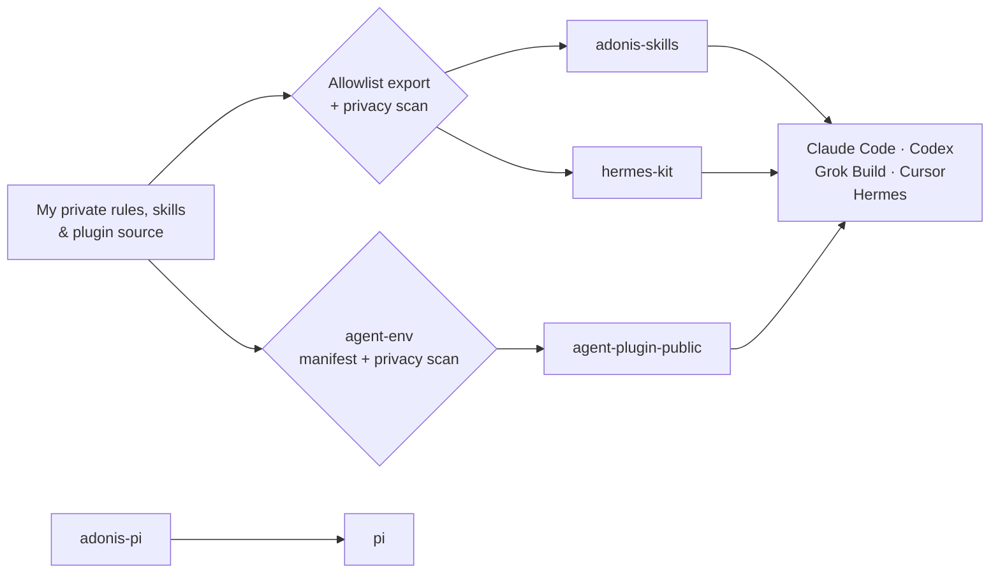

<p align="center">
  Frontend engineer (React · TypeScript) turned coding-agent toolsmith.<br />
  I package the habits that make agents reliable — review loops, workflow gates, permission gates — into things you can install in one line.
</p>

<!-- PROFILE_STATS:START -->
<p align="center">
  <b>44</b> published skills · runs in Claude Code · Codex · Cursor · Hermes · pi · <b>312</b> public commits in the last 30 days
</p>
<!-- PROFILE_STATS:END -->

## Featured Projects

### [sideby](https://github.com/Adonis0123/sideby)

<a href="https://www.npmjs.com/package/sideby"></a> <a href="https://github.com/Adonis0123/sideby/stargazers"></a> <a href="https://github.com/Adonis0123/sideby/commits"></a>

Run work, personal and API-key accounts at the same time, without their configs drifting apart: Claude Code, Codex, Grok Build and pi, plus quota for Antigravity. Each account gets its own directory and terminal, while skills, hooks and settings stay linked to your main account; `sideby doctor --fix` repairs drift. One local panel and a macOS menu bar show every account's 5-hour and weekly quota, and `sideby next` starts the account with the most left. It never reads, prints or sends a credential value.

```bash
npm i -g sideby && sideby new claude work && sideby ui --background
```

<p>
<a href="https://github.com/Adonis0123/sideby">
  <picture>
    <source media="(prefers-color-scheme: dark)" srcset="https://raw.githubusercontent.com/Adonis0123/sideby/main/docs/assets/panel-dark.png" />
    <source media="(prefers-color-scheme: light)" srcset="https://raw.githubusercontent.com/Adonis0123/sideby/main/docs/assets/panel.png" />
    
  </picture>
</a>
</p>

### [agent-env](https://github.com/Adonis0123/agent-env)

<a href="https://github.com/Adonis0123/agent-env/stargazers"></a> <a href="https://github.com/Adonis0123/agent-env/commits"></a>

One manifest for the rules and skills of every AI agent I run: Claude Code, Codex, Grok, pi, Cursor, Hermes and cloud chat bots. It ships them as plugins with a visibility (public, personal, company or local), scans public and personal ones for home paths, emails and secrets before they are written, and `bin/agent-env doctor` checks every machine against the manifest. It also builds [agent-plugin-public](https://github.com/Adonis0123/agent-plugin-public), the plugin of shared rules and general skills you can install directly.

```bash
git clone https://github.com/Adonis0123/agent-env.git && cd agent-env
bin/agent-env check --manifest examples/demo/manifest/habits.toml
```

How my skill, plugin and pi projects fit together:



### [adonis-skills](https://github.com/Adonis0123/adonis-skills)

<a href="https://github.com/Adonis0123/adonis-skills/stargazers"></a> <a href="https://github.com/Adonis0123/adonis-skills/commits"></a>

Agent-agnostic skills for coding agents: review loops, workflow gates, MCP setup, Git delivery and local environment audits. Works in Claude Code, Codex, Cursor, Hermes or any agent that reads `SKILL.md`. · [Live site](https://adonis-skills.vercel.app/)

```bash
npx skills add adonis0123/adonis-skills --list
```

### [hermes-kit](https://github.com/Adonis0123/hermes-kit)

<a href="https://github.com/Adonis0123/hermes-kit/stargazers"></a> <a href="https://github.com/Adonis0123/hermes-kit/commits"></a>

Plugins, skills and field notes for running [Hermes Agent](https://github.com/NousResearch/hermes-agent) day to day, plus docs for a patched Hermes fork. The skills also install into Claude Code and Codex.

```bash
hermes skills tap add Adonis0123/hermes-kit
```

### [adonis-pi](https://github.com/Adonis0123/adonis-pi)

<a href="https://github.com/Adonis0123/adonis-pi/stargazers"></a> <a href="https://github.com/Adonis0123/adonis-pi/commits"></a>

A Pi Package that brings my Claude Code habits to [pi](https://github.com/earendil-works/pi) without forking it: a permission gate, attention notifications, a Claude Code–compatible `AskUserQuestion` tool and the `pin` multi-account launcher.

```bash
git clone https://github.com/Adonis0123/adonis-pi && export PATH="$PWD/adonis-pi/bin:$PATH"
pin setup 1
```

### [gemini-chrome-autoinstall](https://github.com/Adonis0123/gemini-chrome-autoinstall)

<a href="https://github.com/Adonis0123/gemini-chrome-autoinstall/stargazers"></a> <a href="https://github.com/Adonis0123/gemini-chrome-autoinstall/commits"></a> <a href="https://github.com/Adonis0123/gemini-chrome-autoinstall/releases"></a>

A self-healing wrapper that keeps [Gemini-in-Chrome](https://github.com/appsail/Gemini-in-Chrome) working after Chrome updates: it watches for version changes and repairs `Local State` only when it is safe to write. macOS and Windows.

```bash
curl -fsSL https://raw.githubusercontent.com/Adonis0123/gemini-chrome-autoinstall/master/install.sh | bash
```

## Skill of the Week

A different skill from [adonis-skills](https://github.com/Adonis0123/adonis-skills) every week.

<!-- SKILL_OF_WEEK:START -->
**[review-prompt-composer](https://github.com/Adonis0123/adonis-skills/tree/HEAD/skills/review-prompt-composer)** — Compose one repository-local, copy-ready Markdown prompt for another team or AI agent to review Git changes in the same working tree.

```bash
npx skills add adonis0123/adonis-skills --skill review-prompt-composer
```
<!-- SKILL_OF_WEEK:END -->

## Shipped This Week

My latest public commits, refreshed weekly.

<!-- SHIPPED_THIS_WEEK:START -->
- `sideby` [🔖 chore(release): v0.44.0](https://github.com/Adonis0123/sideby/commit/5942478530cf53b7109b96808f621b81c913bc4a) · 2026-11-23
- `sideby` [✨ feat(panel): refresh quota as soon as its files change, and show the account to use now](https://github.com/Adonis0123/sideby/commit/a2714bed42b1c9f65fde19d041f05b0e160d6687) · 2026-11-23
- `sideby` [🐛 fix(panel): keep usage cache across processes and stop rows falling back to reading](https://github.com/Adonis0123/sideby/commit/9a295a79a70850317040a8efa77eee1c86fcb226) · 2026-11-23
- `sideby` [🔖 chore(release): v0.43.0](https://github.com/Adonis0123/sideby/commit/4551bd68a2722cb0daaa856b08d539af11850ba5) · 2026-11-23
- `sideby` [✨ feat(handoff): spread picks by room per session, and add network diagnose](https://github.com/Adonis0123/sideby/commit/c5c548e1a8a0eecc85d099ad77d16a824a789c90) · 2026-11-23
<!-- SHIPPED_THIS_WEEK:END -->

## More Projects

Auto-selected every week from my most recently pushed public repositories.

<!-- RECENT_REPOS:START -->
- **[stars](https://github.com/Adonis0123/stars)** - My GitHub stars and tech posts from X, sorted by starsieve (Last update: 2026-11-22)
- **[starsieve](https://github.com/Adonis0123/starsieve)** - Sort your GitHub stars and X likes/bookmarks into a browsable collection; any agent can be the classifier (Last update: 2026-11-22)
<!-- RECENT_REPOS:END -->

## Latest Releases

The newest release of each featured project, refreshed weekly.

<!-- LATEST_RELEASES:START -->
- **[sideby](https://github.com/Adonis0123/sideby)** [v0.44.0](https://github.com/Adonis0123/sideby/releases/tag/v0.44.0) · 2026-11-23
- **[gemini-chrome-autoinstall](https://github.com/Adonis0123/gemini-chrome-autoinstall)** [v0.6.9](https://github.com/Adonis0123/gemini-chrome-autoinstall/releases/tag/v0.6.9) · 2026-11-23
- **[agent-env](https://github.com/Adonis0123/agent-env)** [v0.1.0](https://github.com/Adonis0123/agent-env/releases/tag/v0.1.0) · 2026-11-10
<!-- LATEST_RELEASES:END -->

## About Me

- Frontend engineer based in Shenzhen, China, working mostly in React and TypeScript.
- These days I spend most of my time building tooling for coding agents: Claude Code, Codex, Grok Build, Cursor, Hermes and pi.
- Everything I publish is exported through an allowlist and a privacy scan before it leaves my machine.

## Tech Stack

<p align="center">
  <a href="https://skillicons.dev">
    
  </a>
</p>

<details>
<summary>Full tech stack details</summary>

### AI Agent Tooling

- Claude Code, Codex, Cursor, Grok Build, Hermes Agent, pi
- Agent skills (`SKILL.md`), plugins, MCP servers

### Languages & Markup

- HTML, CSS, JavaScript, TypeScript
- Sass, Markdown, SVG, Regex

### Frameworks & Build

- React, Next.js, Astro, Tailwind CSS
- Electron, Vite, Webpack, Express

### Runtime & Tools

- Node.js, Git, VSCode, Figma
- Python, GitHub, Cloudflare Workers, CodePen, Stack Overflow

### Infra & DevOps

- PostgreSQL, Docker, GitHub Actions
- Nginx, Cloudflare, Vercel, Linux, Jenkins

</details>

## GitHub Stats

<p align="center">
  <a href="https://github.com/Adonis0123">
    
  </a>
  <a href="https://github.com/Adonis0123">
    
  </a>
</p>

## Contact

<p align="left">
  <a href="https://github.com/Adonis0123">
    
  </a>
  <a href="mailto:adonis20210809@gmail.com">
    
  </a>
</p>

<picture>
  <source media="(prefers-color-scheme: dark)" srcset="https://raw.githubusercontent.com/Adonis0123/Adonis0123/output/github-snake-dark.svg" />
  <source media="(prefers-color-scheme: light)" srcset="https://raw.githubusercontent.com/Adonis0123/Adonis0123/output/github-snake.svg" />
  
</picture>

<p align="center">
  <sub>This profile is refreshed weekly by <a href="https://github.com/Adonis0123/Adonis0123/blob/main/.github/workflows/profile-refresh.yml">GitHub Actions</a> — and edited by coding agents.</sub>
</p>


